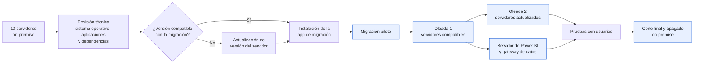
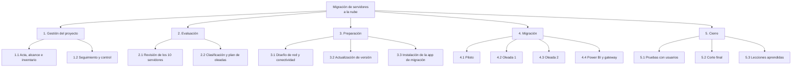
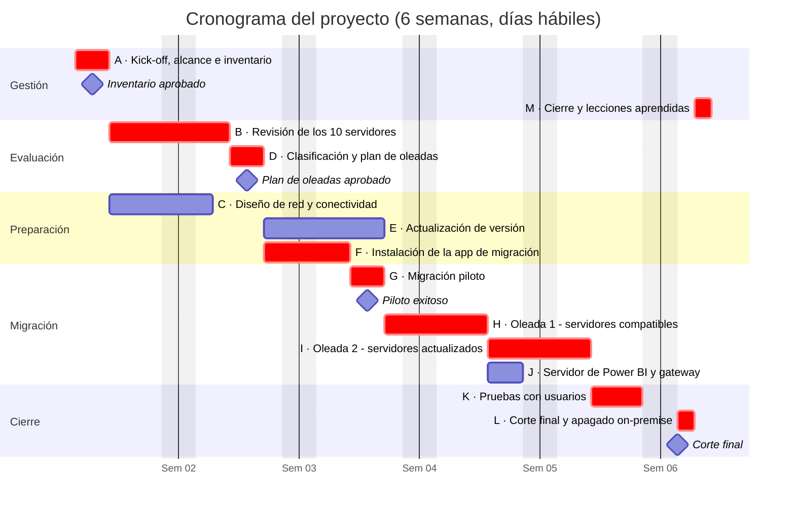
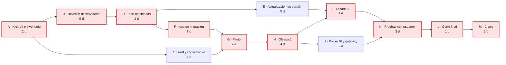

# Migración de servidores on-premise a la nube

> **Proyecto · Dirección de Proyectos de TI**
> Migración de 10 servidores on-premise a la nube, incluido el servidor de Power BI con su gateway de datos, con revisión técnica previa, actualización de versión en los servidores no compatibles y migración por oleadas sin detener la operación.

<!--
  CÓMO USAR ESTE ARCHIVO
  Los comentarios como este NO se ven en GitHub. Sirven de guía para completar el proyecto.
  Reemplaza o amplía los textos donde veas "COMPLETAR". Si no tienes una cifra exacta, no la inventes.
-->

---

## 📋 Resumen

| | |
|---|---|
| **Rol** | Líder de proyecto |
| **Sector** | Operador logístico (aduanas, almacén y transporte) |
| **Equipo** | 3 programadores (revisión de servidores) y 1 especialista de redes |
| **Alcance** | 10 servidores on-premise, incluido el servidor de Power BI con el gateway de datos |
| **Duración planificada** | 6 semanas (27 días hábiles) |
| **Metodología** | Plan por fases con migración por oleadas y control con ruta crítica |

<!-- COMPLETAR:
     - Agrega una fila "Periodo" con el mes y año reales (por ejemplo: "Marzo – abril 2020").
     - Agrega una fila "Plataforma" con la nube de destino (por ejemplo: Azure, AWS) y el nombre de la
       herramienta o app de migración que se instaló en los servidores. Son datos técnicos que suman mucho. -->

---

## 🎯 Contexto y problema

La empresa operaba con **10 servidores on-premise** que soportaban sus sistemas de aduanas, logística y almacén, además del servidor de **Power BI**, donde estaba instalado el **gateway de datos** que alimentaba los reportes de gerencia.

Mantener esa infraestructura implicaba costos de hardware, riesgo de fallas físicas y poca flexibilidad para crecer. La migración a la nube tenía una complicación adicional: **no todos los servidores estaban en condiciones de migrarse directamente**, porque algunos tenían versiones de sistema operativo no compatibles con el proceso de migración.

<!-- COMPLETAR: si recuerdas el motivo principal (fin de soporte del hardware, costos, continuidad
     del negocio, una falla previa), agrégalo aquí. -->

---

## 🧭 Objetivo

Migrar los 10 servidores a la nube **sin interrumpir la operación**, asegurando que los sistemas y los reportes de Power BI siguieran funcionando igual o mejor después de la migración.

**Criterios de éxito:**
- Los 10 servidores operando en la nube.
- Sistemas validados por los usuarios después de cada oleada.
- Reportes de Power BI actualizándose con normalidad a través del gateway migrado.
- Sin pérdida de información y con un plan de vuelta atrás disponible en cada paso.

---

## 📦 Alcance

| Incluido | Fuera de alcance |
|---|---|
| Revisión técnica de los 10 servidores | Rediseño o reprogramación de los sistemas |
| Actualización de versión en servidores no compatibles | Cambio de proveedor de internet |
| Instalación de la app de migración en cada servidor | Migración de estaciones de trabajo de usuarios |
| Diseño de red y conectividad con la nube | |
| Migración por oleadas, incluido el servidor de Power BI y su gateway | |
| Pruebas con usuarios, corte final y apagado de los servidores on-premise | |

---

## 👤 Mi rol

- **Planificación:** definí el alcance, la EDT, el cronograma con ruta crítica, la matriz RACI y el plan de oleadas.
- **Dirección del equipo:** coordiné a 3 programadores en la revisión de los servidores y al especialista de redes en la conectividad.
- **Gestión de riesgos:** definí el plan de contingencia y de vuelta atrás para cada oleada.
- **Comunicación:** coordiné las ventanas de migración con los usuarios y reporté el avance a la gerencia.
- **Cierre:** validé los resultados con los usuarios y documenté las lecciones aprendidas.

---

## 🛠️ Estrategia de migración

Antes de migrar, el equipo revisó cada servidor y lo clasificó según su situación. Eso definió **dos caminos**:

- **Servidores compatibles:** se les instaló la **app de migración** y pasaron a la nube en la primera oleada.
- **Servidores no compatibles:** primero se **actualizó la versión** del servidor y luego se instaló la app para migrarlos en la segunda oleada.
- **Servidor de Power BI:** se migró por separado, con un procedimiento específico para el **gateway de datos**: instalación del gateway en el nuevo servidor, recuperación de su configuración con la clave de recuperación, verificación de los orígenes de datos y prueba de las actualizaciones programadas de los reportes.

<!-- COMPLETAR:
     - Cuántos servidores fueron compatibles y cuántos se actualizaron (por ejemplo: "7 y 3").
     - Desde qué versión a qué versión se actualizaron (por ejemplo: "Windows Server 2008 R2 a 2016").
     - Si el procedimiento del gateway fue distinto al descrito, ajústalo. -->

---

## 🗂️ Dirección del proyecto

El proyecto se planificó en **6 semanas (27 días hábiles)**. Para el control del plazo se usó un cronograma con **ruta crítica**, y la migración se ejecutó **por oleadas** para limitar el impacto en la operación.

<!-- COMPLETAR: las duraciones son una propuesta coherente con un proyecto de este tamaño.
     Ajústalas a lo que realmente ocurrió. Si cambias una, avísame y recalculo la ruta crítica
     para que el Gantt, la red y la tabla sigan cuadrando. -->

### 1. Interesados

| Interesado | Interés en el proyecto | Influencia | Estrategia |
|---|---|---|---|
| Gerencia (sponsor) | Reducir riesgos y costos de infraestructura sin afectar la operación | Alta | Reporte semanal de avance y riesgos |
| Usuarios de aduanas, logística y almacén | Que sus sistemas sigan funcionando | Media | Ventanas de migración acordadas y validación tras cada oleada |
| Usuarios de reportes de Power BI | Reportes actualizados a tiempo | Media | Validación de las actualizaciones programadas |
| Equipo de programadores (3) | Claridad en la revisión y en las tareas | Media | Checklist de revisión por servidor |
| Especialista de redes | Conectividad segura con la nube | Media | Participación en el diseño de red desde el inicio |
| Proveedor de nube | Configuración correcta del entorno de destino | Media | Coordinación técnica en el piloto |

### 2. Estructura de desglose del trabajo (EDT)

### 3. Cronograma (diagrama de Gantt)

Las barras en rojo forman la **ruta crítica**. El eje muestra las semanas del proyecto.

### 4. Red de actividades y ruta crítica

**Ruta crítica: A → B → D → F → G → H → I → K → L → M = 27 días hábiles.**

La revisión de los servidores (B) está en la ruta crítica: un retraso del equipo de programadores movía directamente la fecha de entrega. En cambio, el diseño de red (C) tenía **6 días de holgura**, la actualización de versión (E) **4 días** y la migración de Power BI (J) **2 días**.

| Act. | Actividad | Dur. (d) | Predecesoras | IT | FT | IL | FL | Holgura |
|:---:|---|:---:|:---:|:---:|:---:|:---:|:---:|:---:|
| **A** | **Kick-off, alcance e inventario inicial** | 2 | — | 0 | 2 | 0 | 2 | **0** |
| **B** | **Revisión técnica de los 10 servidores** | 5 | A | 2 | 7 | 2 | 7 | **0** |
| C | Diseño de red y conectividad con la nube | 4 | A | 2 | 6 | 8 | 12 | 6 |
| **D** | **Clasificación de servidores y plan de oleadas** | 2 | B | 7 | 9 | 7 | 9 | **0** |
| E | Actualización de versión en servidores no compatibles | 5 | D | 9 | 14 | 13 | 18 | 4 |
| **F** | **Instalación de la app de migración** | 3 | D | 9 | 12 | 9 | 12 | **0** |
| **G** | **Migración piloto (1 servidor)** | 2 | C, F | 12 | 14 | 12 | 14 | **0** |
| **H** | **Oleada 1: servidores compatibles** | 4 | G | 14 | 18 | 14 | 18 | **0** |
| **I** | **Oleada 2: servidores actualizados** | 4 | E, H | 18 | 22 | 18 | 22 | **0** |
| J | Migración del servidor de Power BI y gateway | 2 | H | 18 | 20 | 20 | 22 | 2 |
| **K** | **Pruebas y validación con usuarios** | 3 | I, J | 22 | 25 | 22 | 25 | **0** |
| **L** | **Corte final y apagado on-premise** | 1 | K | 25 | 26 | 25 | 26 | **0** |
| **M** | **Cierre y lecciones aprendidas** | 1 | L | 26 | 27 | 26 | 27 | **0** |

IT/FT: inicio y fin más tempranos · IL/FL: inicio y fin más tardíos · en días hábiles desde el inicio del proyecto. En negrita, las actividades críticas.

### 5. Hitos

| Hito | Semana | Criterio de cumplimiento |
|---|:---:|---|
| Inventario aprobado | 1 | Lista de los 10 servidores y sus sistemas validada por el sponsor |
| Plan de oleadas aprobado | 2 | Servidores clasificados en compatibles y por actualizar |
| Piloto exitoso | 3 | Primer servidor operando en la nube y validado |
| Power BI y gateway en la nube | 4 | Reportes actualizándose desde el nuevo gateway |
| Validación aprobada | 5 | Usuarios conformes con todos los sistemas |
| Corte final | 6 | Servidores on-premise apagados |

### 6. Matriz RACI

**R** = Responsable · **A** = Aprueba · **C** = Consultado · **I** = Informado

| Entregable | Líder de proyecto (yo) | Programadores (3) | Redes | Usuarios clave | Sponsor |
|---|:---:|:---:|:---:|:---:|:---:|
| Acta, alcance e inventario | R | C | C | I | **A** |
| Revisión técnica de los servidores | **A** | R | C | | |
| Plan de oleadas | R | C | C | C | **A** |
| Diseño de red y conectividad | **A** | I | R | | |
| Actualización de versión | **A** | R | C | I | |
| Instalación de la app de migración | **A** | R | C | | |
| Migración por oleadas | **A** | R | R | I | I |
| Migración de Power BI y gateway | **A** | R | C | C | I |
| Pruebas y validación | **A** | C | C | R | I |
| Corte final | R | C | C | I | **A** |
| Cierre y lecciones aprendidas | R | C | C | I | **A** |

### 7. Plan de comunicaciones

| Reunión o reporte | Frecuencia | Participantes | Objetivo |
|---|---|---|---|
| Reunión de seguimiento | Diaria (15 min) | Equipo del proyecto | Avance por servidor, bloqueos y siguiente paso |
| Aviso de ventana de migración | Antes de cada oleada | Usuarios afectados | Informar fecha, hora y sistemas involucrados |
| Validación posterior | Después de cada oleada | Usuarios clave | Confirmar que los sistemas funcionan |
| Reporte de estado | Semanal | Sponsor | Avance frente a la ruta crítica, riesgos y decisiones |
| Informe de cierre | Al final | Sponsor e interesados | Resultados y lecciones aprendidas |

### 8. Gestión de riesgos

| ID | Riesgo | Prob. | Impacto | Respuesta | Acción |
|:---:|---|:---:|:---:|:---:|---|
| R1 | Servidores con versión no compatible con la migración | Alta | Alto | Mitigar | Revisión técnica previa y actualización de versión antes de migrar |
| R2 | Interrupción de la operación durante la migración | Media | Alto | Mitigar | Migración por oleadas en ventanas fuera del horario de operación |
| R3 | Reportes de Power BI sin actualizar tras mover el gateway | Media | Alto | Mitigar | Respaldo de la clave de recuperación y prueba de las actualizaciones programadas |
| R4 | Dependencias entre sistemas no documentadas | Media | Medio | Mitigar | Checklist de dependencias en la revisión de cada servidor y migración piloto |
| R5 | Problemas de conectividad con la nube | Media | Alto | Mitigar | Diseño de red validado antes del piloto |
| R6 | Retraso en la revisión de servidores, que está en la ruta crítica | Media | Medio | Mitigar | Reparto de servidores entre los 3 programadores y seguimiento diario |

### 9. Plan de contingencia y vuelta atrás

- **Respaldo completo** de cada servidor antes de migrarlo.
- **Servidor on-premise apagado pero disponible** hasta que los usuarios validaran la versión en la nube.
- **Criterio de vuelta atrás definido** antes de cada ventana: si un sistema no superaba la validación, se volvía a encender el servidor original.
- **Migración piloto** con un servidor de bajo riesgo para validar el procedimiento antes de las oleadas.

<!-- COMPLETAR: si se llegó a usar la vuelta atrás en algún servidor, cuéntalo. Muestra que el plan funcionó. -->

---

## 📈 Resultados

- **10 servidores migrados** a la nube, incluido el servidor de Power BI.
- **Gateway de datos operativo** en la nube, con los reportes de gerencia actualizándose con normalidad.
- **Servidores no compatibles actualizados**, lo que además redujo riesgos de seguridad por versiones antiguas.
- Migración realizada **por oleadas, sin detener la operación** de aduanas, logística y almacén.

<!-- COMPLETAR con cifras si las tienes. Ejemplos:
     - "Plazo: 6 semanas planificadas y X reales"
     - "Tiempo de inactividad por servidor: menos de X horas"
     - "Ahorro estimado en costos de infraestructura: X%"
     - "Incidentes después de la migración: X" -->

---

## 💡 Lecciones aprendidas

- **Revisar antes de migrar evita sorpresas:** la revisión técnica permitió detectar a tiempo los servidores no compatibles.
- **Un piloto vale más que cualquier plan:** validar el procedimiento con un servidor redujo el riesgo de las oleadas.
- **El gateway de Power BI requiere su propio plan:** guardar la clave de recuperación y probar las actualizaciones es indispensable.
- **La comunicación con los usuarios es parte de la migración:** las ventanas acordadas y la validación después de cada oleada generaron confianza.

---

Los nombres de la empresa, servidores y sistemas se omiten por confidencialidad.

📂 Más proyectos en mi portafolio: **[Dirección de Proyectos](https://enzotarazona.github.io/direccion-proyectos/)** · **[Inicio](https://enzotarazona.github.io)**
